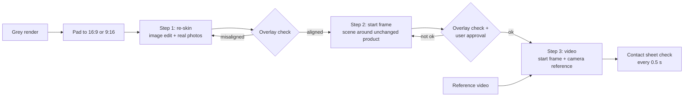
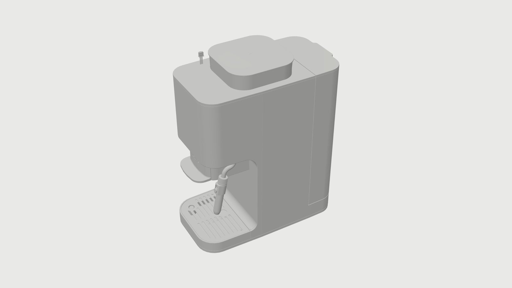
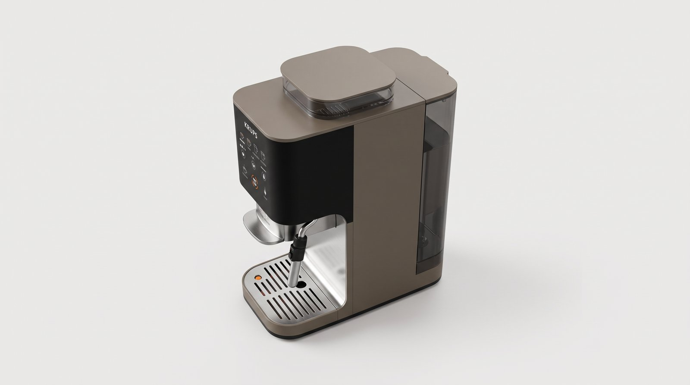
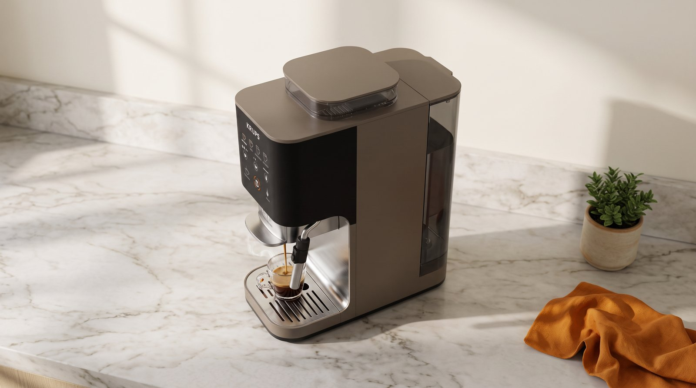
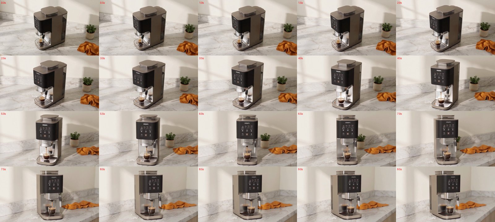

# render-to-product-video

Turn a plain grey 3D render of a product into a photorealistic product video, without the product ever changing shape.

You provide a grey render (the exact camera angle you want), a few real photos of the product (for true materials and colours) and a reference video (the camera move you want). The pipeline produces three things, in order:

1. **Re-skin**: the grey render repainted with real materials, geometry unchanged.
2. **Start frame**: the same product, unchanged, placed in the scene and lighting you describe.
3. **Video**: a short clip that starts exactly on the start frame and follows the camera path of your reference video.

It is written as a [Claude skill](skill/SKILL.md) (Claude does the steps and runs the checks), but every step is a plain image-edit or video call plus a few local scripts, so it works with any tool that offers the same capabilities.

> **Disclaimer.** The example in this repository uses images of a commercial coffee machine, for illustration only. All product names, brands, logos and designs belong to their respective owners. This project is not affiliated with, endorsed by or sponsored by any brand shown. See [DISCLAIMER.md](DISCLAIMER.md).

## Why this works

Asking an image or video model to "make a product shot of X from this angle" usually deforms the product: proportions drift, parts move, perspective changes. This pipeline avoids that with three rules:

- **The render is the geometric anchor.** Every generation is an edit of an image that already has the right shape, never a generation from scratch.
- **One thing changes per step.** Step 1 changes only materials. Step 2 changes only the environment. Mixing both in one edit is what makes the perspective drift.
- **Every step is verified with code before the next one.** A 50% overlay of the input and the output shows immediately whether contours and proportions still line up. Verification is local, instant and costs no generation credits.



## What you need

| Input | Purpose |
|---|---|
| Grey render of the product | Fixes geometry, camera angle and proportions |
| 1-2 real photos of the product (front, side) | Real colours and materials; also used to keep the product correct when the camera reveals other sides |
| Reference video of the camera move | Only the camera path and timing are copied |
| Scene description or photos | The environment and lighting of the start frame |

Tools:

- An **image editing model** that accepts several input images and keeps unedited regions stable. The example uses Nano Banana 2.1 (`google/nano-banana-2.1/edit` on fal).
- A **video model with reference inputs** (a start image plus a video used as motion reference). The example uses Seedance 2.5 (`bytedance/seedance-2.5/us/reference-to-video` on fal).
- Python 3.9+ with Pillow and numpy, and `ffmpeg` on the PATH, for the local scripts.

## Quick start

```bash
git clone https://github.com/Bagareal/render-to-product-video
cd render-to-product-video
pip install -r requirements.txt

# 1. Make sure the render has the target aspect ratio (padding only, no cropping)
python3 -I scripts/pad_to_ratio.py render.png render_16x9.png 16:9

# 2. Generate the re-skin with your image model (see docs/prompts.md), then verify it
python3 -I scripts/compare.py render_16x9.png reskin.png side_by_side.png blend.png

# 3. Generate the start frame from the re-skin, verify, and review it yourself

# 4. Inspect the camera reference before writing the video prompt
python3 -I scripts/contact_sheet.py reference.mp4 reference_sheet.png 2

# 5. Generate the video, then inspect it
python3 -I scripts/contact_sheet.py output.mp4 output_sheet.png 2
```

Using Claude: install the skill from [`skill/SKILL.md`](skill/SKILL.md) and ask for a product video from a render. Claude collects the inputs, runs the steps, stops to show you the start frame, and only then generates the video.

## Repository layout

| Path | Content |
|---|---|
| [`skill/SKILL.md`](skill/SKILL.md) | The skill: full instructions for Claude |
| [`scripts/`](scripts) | `pad_to_ratio.py`, `compare.py`, `contact_sheet.py` |
| [`docs/workflow.md`](docs/workflow.md) | The pipeline step by step, with the reasoning |
| [`docs/prompts.md`](docs/prompts.md) | Prompt templates with placeholders |
| [`docs/verification.md`](docs/verification.md) | How to read the checks (IoU, overlay, contact sheet) |
| [`docs/models.md`](docs/models.md) | Model roles, parameters and limits, and how to swap models |
| [`docs/troubleshooting.md`](docs/troubleshooting.md) | Known failure modes and fixes |
| [`examples/kitchen-orbit/`](examples/kitchen-orbit) | A complete worked example with screenshots and the output video |

## Example

Grey render, re-skin, start frame and the first seconds of the output video. The full walkthrough, with the overlay checks and the camera reference, is in [`examples/kitchen-orbit`](examples/kitchen-orbit/README.md).

| Grey render | Re-skin | Start frame |
|---|---|---|
|  |  |  |



## Limitations

- Re-running a generation never gives an identical result. Keep an accepted result.
- Video models can still add small artefacts (a stray transparent object, a tiny coloured light). Always inspect the contact sheet.
- Small text on product panels can be unreadable at 720p; use 1080p when legibility matters.
- A 16:9 camera reference used for a 9:16 video is copied as a path only, and the framing can change.
- The IoU check is unreliable when the background changes a lot (a scene, a dark background). Use the overlay.

## License

[MIT](LICENSE). The example media are illustrative and are not covered by the license; see [DISCLAIMER.md](DISCLAIMER.md).
