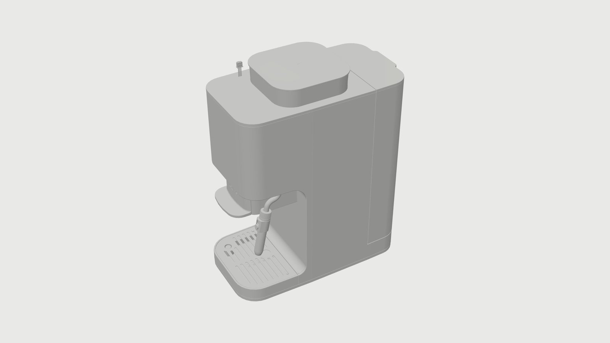
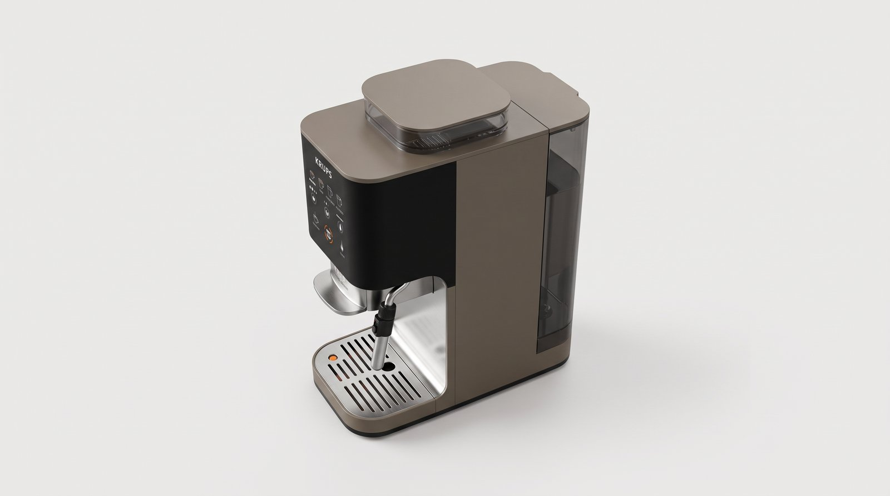
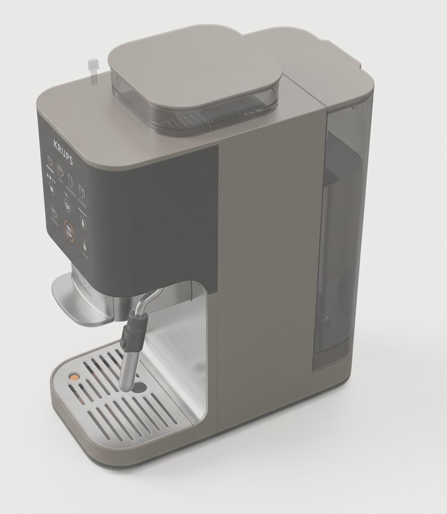
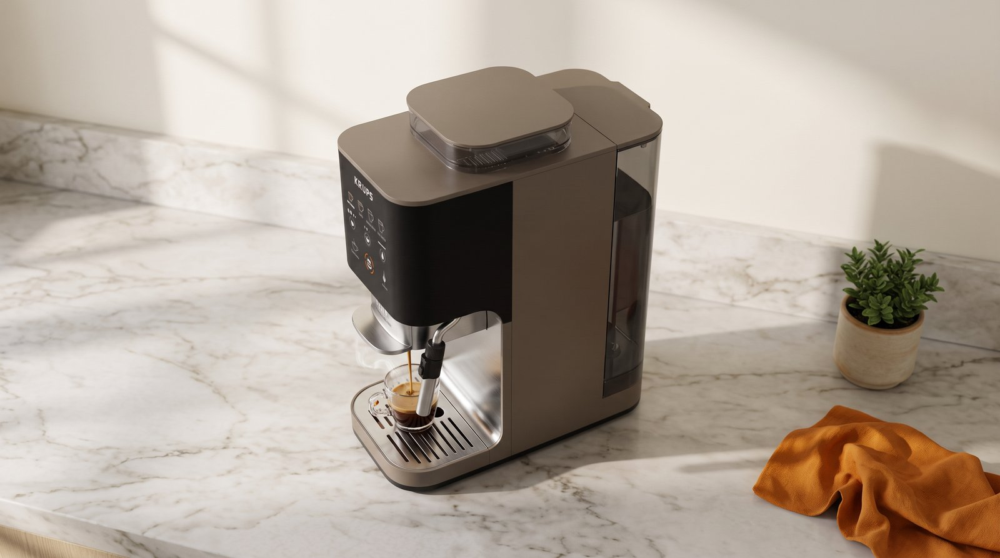
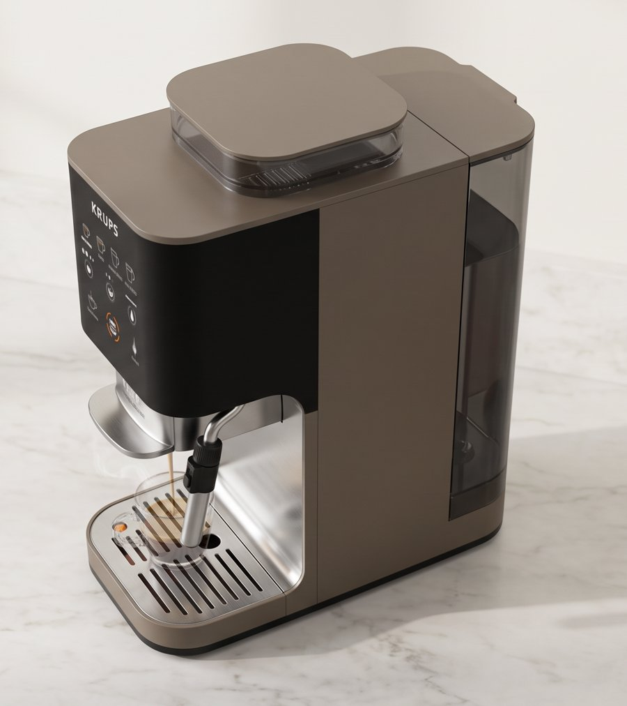
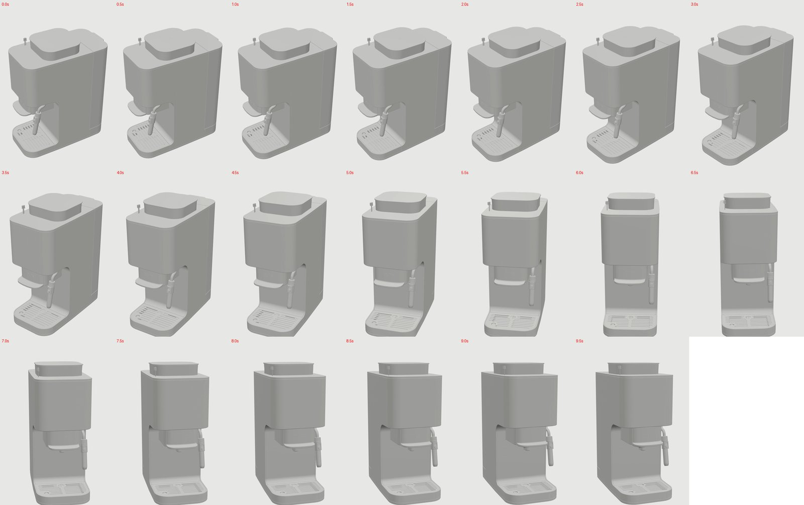
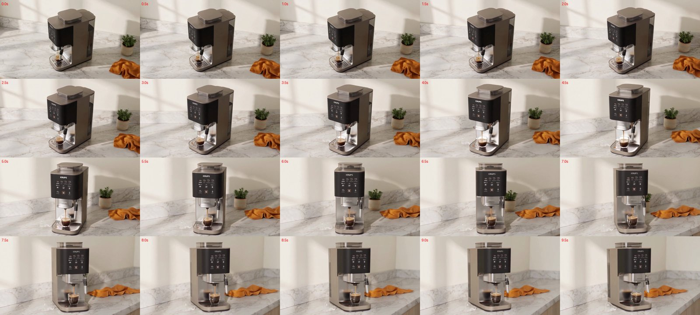

# Example: kitchen scene, 10 s continuous orbit

> **For illustration only.** The product shown is a commercial coffee machine. Brands, logos and designs belong to their owners; this project is not affiliated with them. The media in this folder are not covered by the repository license. See [DISCLAIMER](../../DISCLAIMER.md).

A complete run of the pipeline: grey render in, photorealistic kitchen video out.

## Inputs

- A grey 3D render of the coffee machine at a three-quarter high angle.
- Two real photos of the machine (front and side), used for colours and materials. They are not reproduced here.
- A reference video: a 10 s grey-render clip with a continuous orbit around the machine. Its camera path is shown below.
- Scene brief: light marble countertop, cream wall, a small plant, a saturated orange kitchen towel; soft daylight from the left with the soft shadow of a window on the wall; a small cup with a little coffee, the stream still running, a bit of steam.
- Settings: 16:9, 10 s, no audio.

The prompts used are the templates in [docs/prompts.md](../../docs/prompts.md) filled with these values.

## Step 1: pad the render

The render was already 16:9, so the padding step was skipped. For other ratios:

```bash
python3 -I scripts/pad_to_ratio.py render.png render_16x9.png 16:9
```



## Step 2: re-skin

The grey render repainted with the real materials (taupe matte plastic body, black front panel, brushed stainless steel drip tray, smoked transparent water tank), on the same plain grey background, with no scene.



### Check: overlay of render and re-skin

The 50% overlay shows no double contours: silhouette, seams, panel edges and the drip tray line up. This is what allowed the pipeline to move on.

```bash
python3 -I scripts/compare.py render_16x9.png reskin.png side_by_side.png blend.png
```



## Step 3: start frame

The scene is built around the unchanged re-skin: marble top, cream wall, plant, towel, soft window shadow, a cup under the spout with the stream still running.



### Check: overlay of re-skin and start frame

The machine stays sharp in the overlay: it did not move or change size. (The IoU is not meaningful here, because the background is no longer plain; see [docs/verification.md](../../docs/verification.md).)



At this point the start frame is shown to the user. The video is generated only after they approve it.

## Step 4: study the camera reference

The reference was inspected every 0.5 s. The camera starts high on a three-quarter view, lowers and turns continuously, passes the front view at about 6 s without stopping, and keeps going until the end of the clip.

```bash
python3 -I scripts/contact_sheet.py reference.mp4 reference_sheet.png 2
```



## Step 5: video

Start frame as the exact first frame, the real photos for the sides revealed by the orbit, the reference as camera motion only (explicitly not its grey look or plain background). Parameters: 16:9, 10 s, 720p, audio off.

Output: [`output.mp4`](output.mp4)

## Step 6: inspect the output

```bash
python3 -I scripts/contact_sheet.py output.mp4 output_sheet.png 2
```



What the check showed:

- **Camera:** follows the reference orbit continuously, passing the front view and continuing past it.
- **Product and scene:** the machine stays rigid, the kitchen stays constant and the first frame matches the approved start frame. The coffee stream and the cup behave naturally.
- **Defects:** a small stray transparent object appears near the base of the machine in the last seconds. It is a model artefact and was accepted for this example. Small text on the front panel is only partly readable at 720p; 1080p is recommended when legibility matters.
